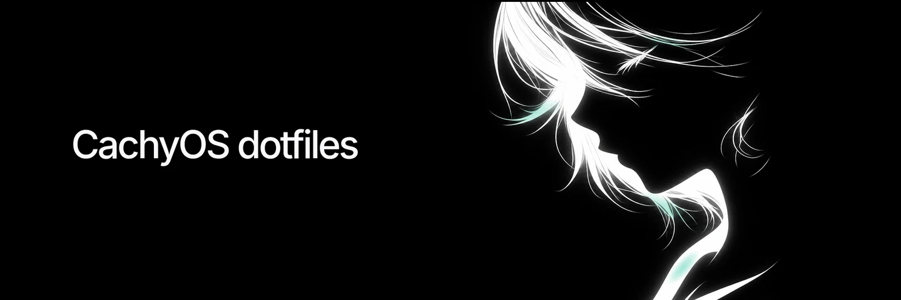

<a href="https://denoax.github.io/cachyos-amethyst-dotfiles/"><picture><source media="(prefers-reduced-motion: reduce)" srcset="assets/banner/cachyos-dotfiles-lagoon-still.webp"></picture></a>

# CachyOS Amethyst

A monochrome Hyprland desktop built around Caelestia, with eleven accent colors, a keyboard-driven shell and a VS Code workspace for competitive programming.

**[Enter the interactive showcase ↗](https://denoax.github.io/cachyos-amethyst-dotfiles/)** · [Installation and rollback](docs/INSTALL.md) · [Keyboard shortcuts](docs/SHORTCUTS.md)

Drag the crystal, scroll down to the recording panels and open **Colors** to switch the desktop palette. The river leads to the download and setup guide.

## Install on CachyOS

Start in a working CachyOS Hyprland session and install the [prerequisites](packages/README.md). Use the [alpha.2 ZIP](https://github.com/Denoax/cachyos-amethyst-dotfiles/archive/refs/tags/v0.1.0-alpha.2.zip) for the current dock, desktop controls, workspace overview and wallpaper picker. From the extracted repository, review the laptop profile.

```sh
./install.sh doctor
./install.sh plan --profile laptop --with shell-patch
```

Review the file plan and follow the [installation guide](docs/INSTALL.md) to apply, verify and retain the transaction ID for rollback.

**Experimental alpha.** Fresh installation, first login and physical-laptop acceptance remain open. See [compatibility](docs/COMPATIBILITY.md) and [verification](docs/VERIFICATION.md) for the tested configurations and current portal issues.

[VS Code setup](docs/VSCODE.md) · [Troubleshooting](docs/TROUBLESHOOTING.md) · [Updates](docs/UPDATE.md) · [Showcase files](https://github.com/Denoax/cachyos-amethyst-dotfiles/tree/gh-pages) · [Asset credits](docs/ASSETS.md) · [License](LICENSE)
