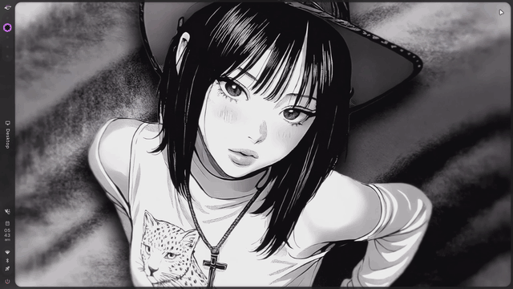
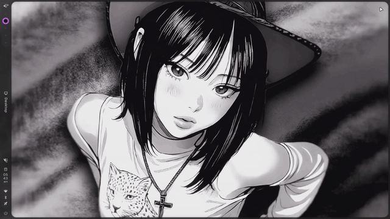
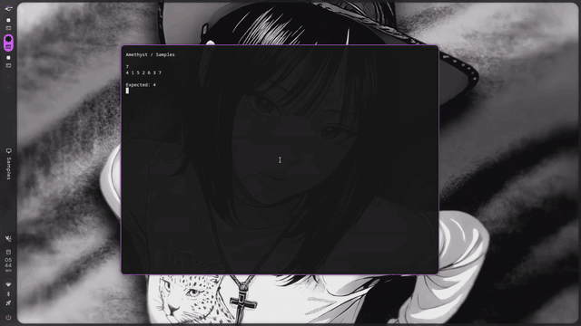
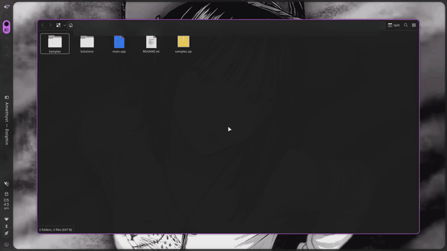
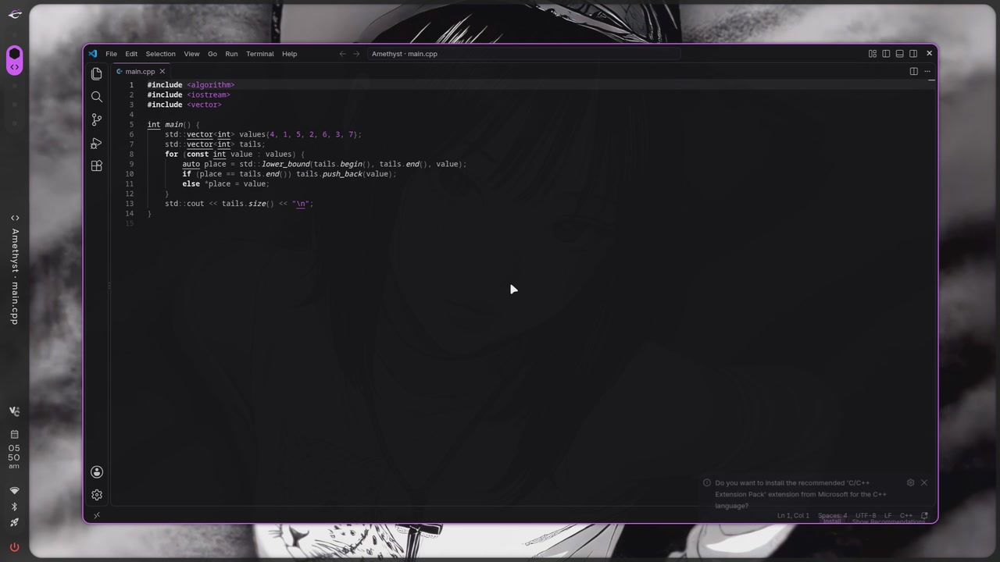

<picture>
  <source media="(prefers-reduced-motion: reduce)" srcset="site/public/media/banner.png">
  <source type="image/webp" srcset="site/public/media/banner.webp">
  
</picture>

A personal CachyOS desktop with Hyprland and Caelestia.

[Installation & recovery](docs/INSTALL.md) · [Shortcuts](docs/SHORTCUTS.md) · [Compatibility](docs/COMPATIBILITY.md) · [Run the showcase](site/README.md)

**Experimental alpha.** Source-PC footage is not fresh-install or physical-laptop acceptance. Portal failures remain open. The portfolio-based website is a visual review candidate; this branch creates no production release.

| Launcher | Dashboard |
| --- | --- |
|  |  |
| [Full-size video](site/public/media/launcher.mp4) · [Still](site/public/media/launcher.jpg) | [Full-size video](site/public/media/dashboard.mp4) · [Still](site/public/media/dashboard.jpg) |

| Gather & restore | Files |
| --- | --- |
|  |  |
| <kbd>Super</kbd> + <kbd>D</kbd> · [Full-size video](site/public/media/gather.mp4) | <kbd>Super</kbd> + <kbd>E</kbd> · [Full-size video](site/public/media/dolphin.mp4) |

The clips retain the actual wallpaper and normal application/compositor opacity. Dolphin’s address bar and autocomplete are blurred to keep local paths private. They use isolated demo data and run at normal speed, without audio. Gather restoration was checked across three outputs, including floating geometry. The terminal group shows real resource values.

[Desktop](site/public/media/desktop.mp4) · [Terminal group](site/public/media/terminal-group.mp4) · [Shortcut guide](site/public/media/shortcuts.mp4) · [Clipboard](site/public/media/clipboard.mp4) · [Audio controls](site/public/media/audio.mp4) · [Notification](site/public/media/notification.mp4)

[Editor appearance](site/public/media/editor.mp4) · [Profile and language tools](docs/VSCODE.md) · [Discover failure state](site/public/media/discover.mp4)

Discover’s isolated demo profile could not find the requested Flatpak application. The clip is a failure state; no successful installation or sandbox launch is asserted. Audible output, microphone capture, screen sharing, lock/unlock and physical laptop behavior are not established by these clips.

Start with [installation and recovery](docs/INSTALL.md). Review the generated file plan before applying it; retain the transaction ID for rollback. The installer manages selected user files and does not install the OS or change boot, encryption or GPU drivers.

[Verification](docs/VERIFICATION.md) · [Troubleshooting](docs/TROUBLESHOOTING.md) · [Updates](docs/UPDATE.md) · [Asset credits](docs/ASSETS.md) · [License](LICENSE)

[Banner GIF](site/public/media/banner.gif) · [Banner MP4](site/public/media/banner.mp4) · [Static banner](site/public/media/banner.png)

The showcase adapts the owner's [pinned portfolio](https://github.com/Denoax/portfolio/tree/72a3c7a2a75913de64d8baf1591282acd19d181c), including [Rare UI's GooeyNav](https://www.rareui.com/components/gooeynav). The existing wallpaper retains its [original rights](docs/ASSETS.md); its raw source is excluded from this distribution. Motion remains subject to owner visual review.
