<div align="center">

# Amethyst

**A CachyOS workstation, in motion.**

Hyprland + Caelestia. Black, white, and the exact Amethyst accent.

<a href="https://denoax.github.io/cachyos-amethyst-dotfiles/#desktop-loop"><picture><source media="(prefers-reduced-motion: reduce)" srcset="showcase/revision-2/assets/desktop.png">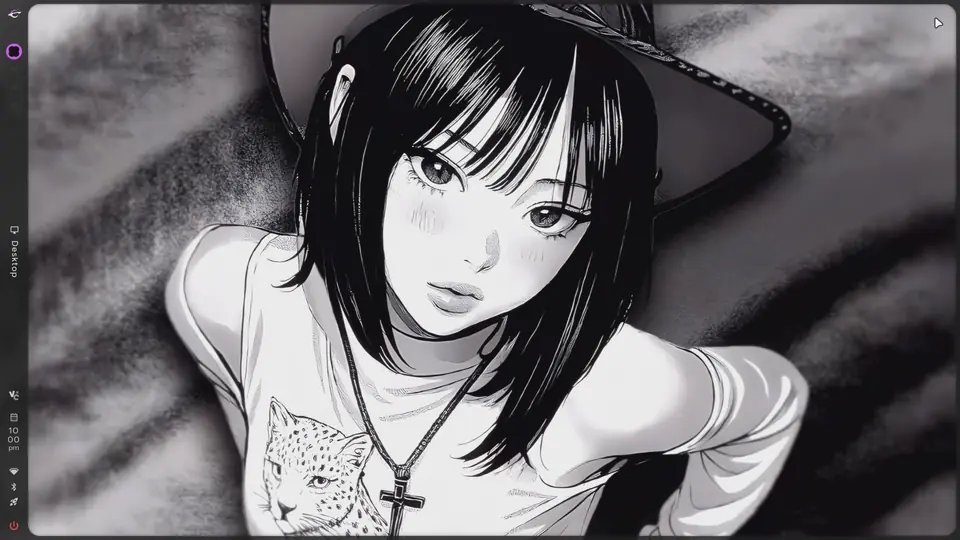</picture></a>

[Watch the tour](https://denoax.github.io/cachyos-amethyst-dotfiles/) · [Explore the films](https://denoax.github.io/cachyos-amethyst-dotfiles/#clip-library) · [Install](#install-and-recover) · [Shortcuts](docs/SHORTCUTS.md) · [Tested scope](docs/VERIFICATION.md)

[Static hero](showcase/revision-2/assets/desktop.png) · [Controllable hero loop](https://denoax.github.io/cachyos-amethyst-dotfiles/#desktop-loop)

</div>

**Experimental alpha.** This is source-PC footage. Fresh installation, first login and physical laptop acceptance remain pending; the screen-sharing and Secret portal failures remain open. V2 motion review is pending. [Validation and current limits](showcase/revision-2/REVIEW.md).

## The desktop

The background keeps moving. Caelestia's rail, launcher and dashboard give it room; the applications carry the same setting into the work. VS Code, Dolphin and Discover are filmed at **0.78 opacity**, with the exact `#d559ff` syntax accent preserved.

[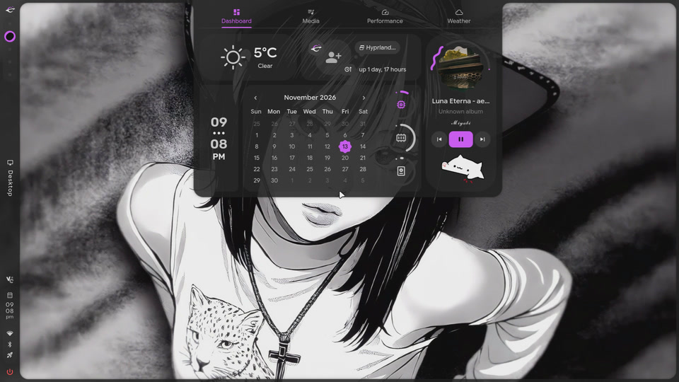](https://denoax.github.io/cachyos-amethyst-dotfiles/#dashboard)

A read-only view of the current dashboard: calendar, resources and media metadata. The capture has no audio, and it leaves existing playback alone.

[The chaptered desktop film](https://denoax.github.io/cachyos-amethyst-dotfiles/#desktop) · [Full-resolution stills](https://denoax.github.io/cachyos-amethyst-dotfiles/#stills-section) · [Source and edit decisions](showcase/revision-2/film.json)

## Move without thinking

Search for an application, pick a window, gather the visible work, then put it back. The guide records the bindings that are actually shipped.

[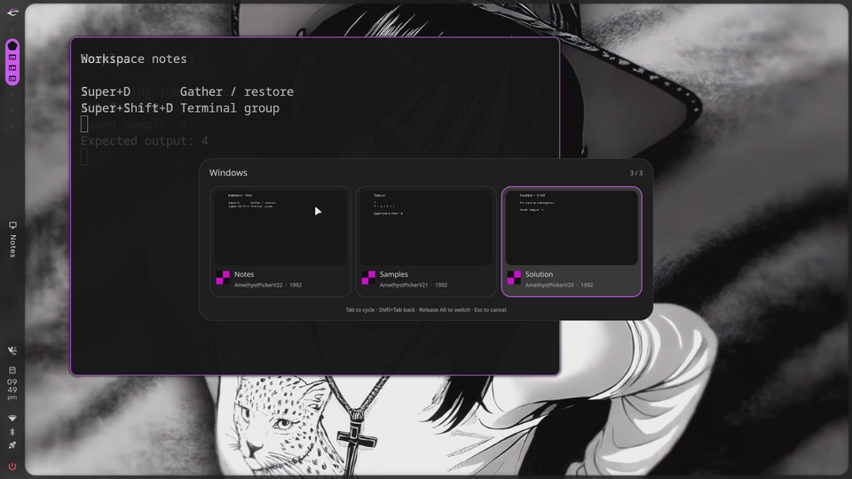](https://denoax.github.io/cachyos-amethyst-dotfiles/#picker)

| Gather and restore | The on-demand terminal group |
|---|---|
| [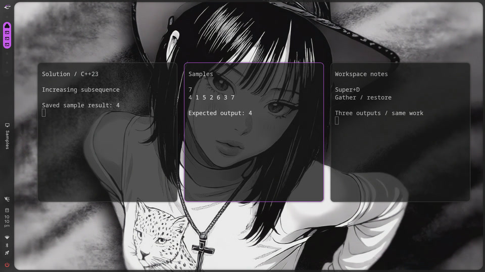](https://denoax.github.io/cachyos-amethyst-dotfiles/#gather) | [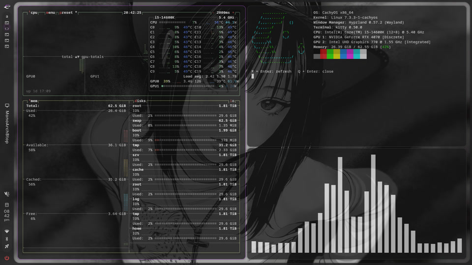](https://denoax.github.io/cachyos-amethyst-dotfiles/#terminal-group) |
| <kbd>Super</kbd> + <kbd>D</kbd> — restore the same workspaces and floating geometry. | <kbd>Super</kbd> + <kbd>Shift</kbd> + <kbd>D</kbd> — open or close the three owned terminals. |

Gather restoration was checked across all three connected outputs. Three terminal-group rehearsal cycles retained exactly three children and stable sampled geometry. Continuous motion review remains separate. The visual picker uses the current component with a capture-only allowlist so private windows never enter its thumbnails.

[Launcher](https://denoax.github.io/cachyos-amethyst-dotfiles/#launcher) · [Window picker](https://denoax.github.io/cachyos-amethyst-dotfiles/#picker) · [Shortcut guide](https://denoax.github.io/cachyos-amethyst-dotfiles/#shortcuts)

## Built for problem solving

Official Microsoft VS Code, Monochromator Dark Amethyst, and a real C++23 workflow. The new example follows an increasing subsequence through compilation, saved input, a breakpoint and local variables. Code is enlarged for filming; the exported profile keeps its original settings.

[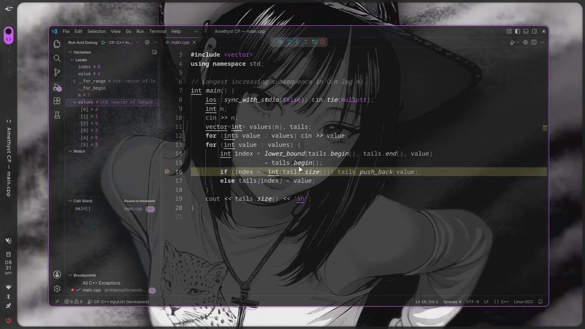](https://denoax.github.io/cachyos-amethyst-dotfiles/#cpp-debug)

https://github.com/user-attachments/assets/0d7fdc9e-deb7-4a56-a5d7-a6da3482c1a5

*Native GitHub video: the actual breakpoint, local variables and step. Continuous human motion review remains pending.*

[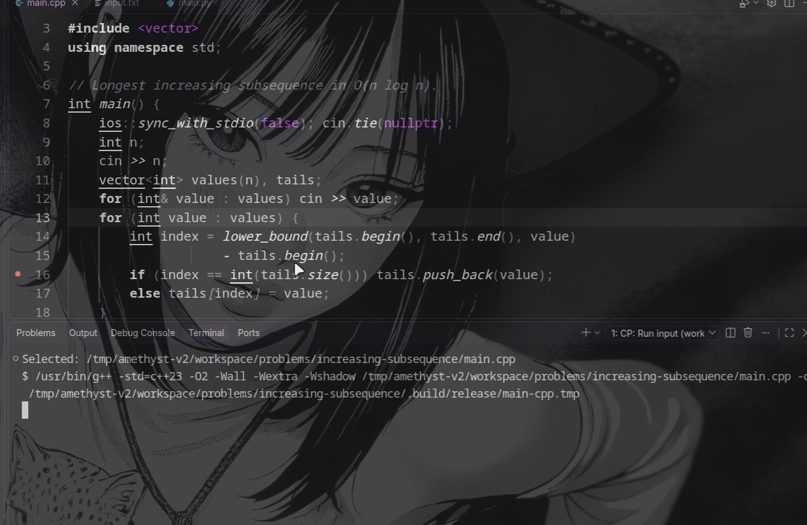](https://denoax.github.io/cachyos-amethyst-dotfiles/#cpp-build)

*Editor detail from the full desktop recording. Open the player fullscreen for code and debugger inspection.*

| Action | Working route |
|---|---|
| <kbd>F6</kbd> | Compile and run saved `input.txt`; compare actual output |
| <kbd>Shift</kbd> + <kbd>F6</kbd> | Compile and accept interactive terminal input |
| <kbd>F5</kbd> / <kbd>F10</kbd> | GDB breakpoint, variables and stepping |
| <kbd>Ctrl</kbd> + <kbd>Alt</kbd> + <kbd>N</kbd> | Create a new problem without overwriting another |
| Samples / stress tasks | Check fixtures and save a replayable counterexample |

Python and Java have genuine task runs as well. The stress demonstration deliberately includes a faulty solution: its counterexample and exit 1 are the expected result, rather than a passing submission.

[C++ build and saved input](https://denoax.github.io/cachyos-amethyst-dotfiles/#cpp-build) · [Interactive input](https://denoax.github.io/cachyos-amethyst-dotfiles/#cpp-interactive) · [GDB](https://denoax.github.io/cachyos-amethyst-dotfiles/#cpp-debug) · [Templates](https://denoax.github.io/cachyos-amethyst-dotfiles/#templates) · [Python](https://denoax.github.io/cachyos-amethyst-dotfiles/#python) · [Java](https://denoax.github.io/cachyos-amethyst-dotfiles/#java) · [Samples and the planted bug](https://denoax.github.io/cachyos-amethyst-dotfiles/#samples-stress)

[Profile, language prerequisites and exact commands →](docs/VSCODE.md)

## Daily Linux

A disposable file workspace in Dolphin. A Flatpak-only catalog in Discover. Both keep the animated background visible, with the same dark palette and 0.78 presentation opacity.

| Files and archives | Applications and their source |
|---|---|
| [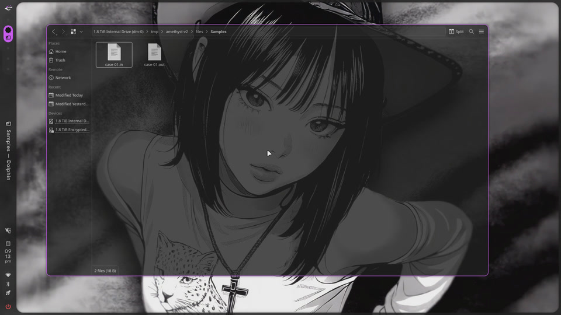](https://denoax.github.io/cachyos-amethyst-dotfiles/#dolphin) | [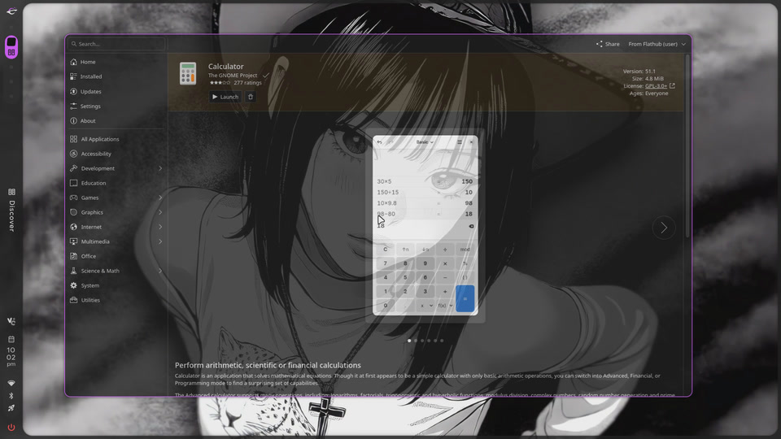](https://denoax.github.io/cachyos-amethyst-dotfiles/#discover) |

The new catalog footage and the sandboxed-launch evidence are identified separately. A fresh Calculator launch in this V2 session failed at its document-portal bind path. The gallery retains the previously verified **alpha.1 Flatpak launch as labeled archival footage**; it is not a new launch pass.

[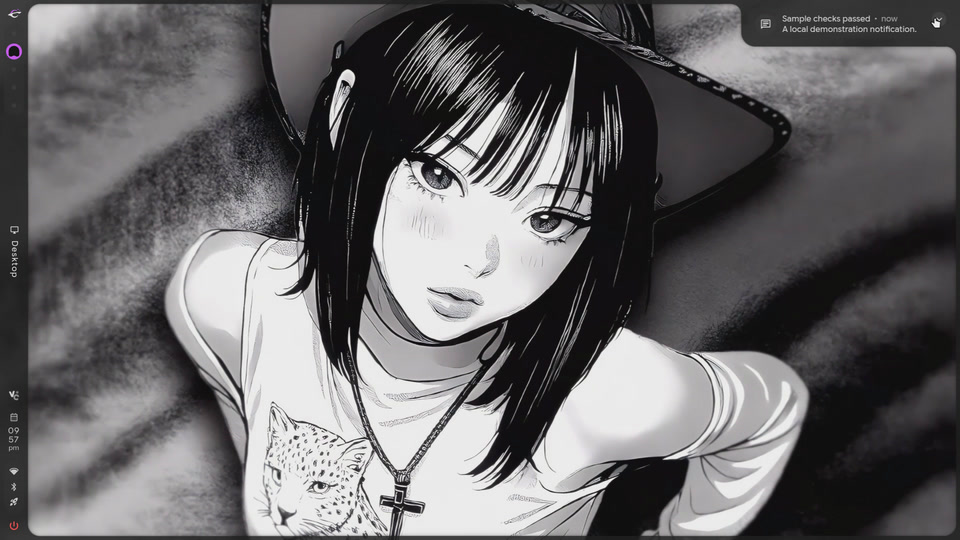](https://denoax.github.io/cachyos-amethyst-dotfiles/#notification)

The clipboard picker uses an isolated demo database. The notification is a real local request. Audio is shown as a read-only control surface; audible output, microphone capture and device switching remain untested.

[Clipboard](https://denoax.github.io/cachyos-amethyst-dotfiles/#clipboard) · [Notifications](https://denoax.github.io/cachyos-amethyst-dotfiles/#notification) · [Audio OSD](https://denoax.github.io/cachyos-amethyst-dotfiles/#audio) · [Archival Flatpak launch](https://denoax.github.io/cachyos-amethyst-dotfiles/#flatpak-archive)

## More surfaces

[Open the responsive still gallery](https://denoax.github.io/cachyos-amethyst-dotfiles/#stills-section) for the full set of settled views and individual films. It has a motion-free route, explicit play/pause/fullscreen controls, keyboard access and deep chapter links.

<details><summary>Additional full-size desktop views</summary>

### Launcher

[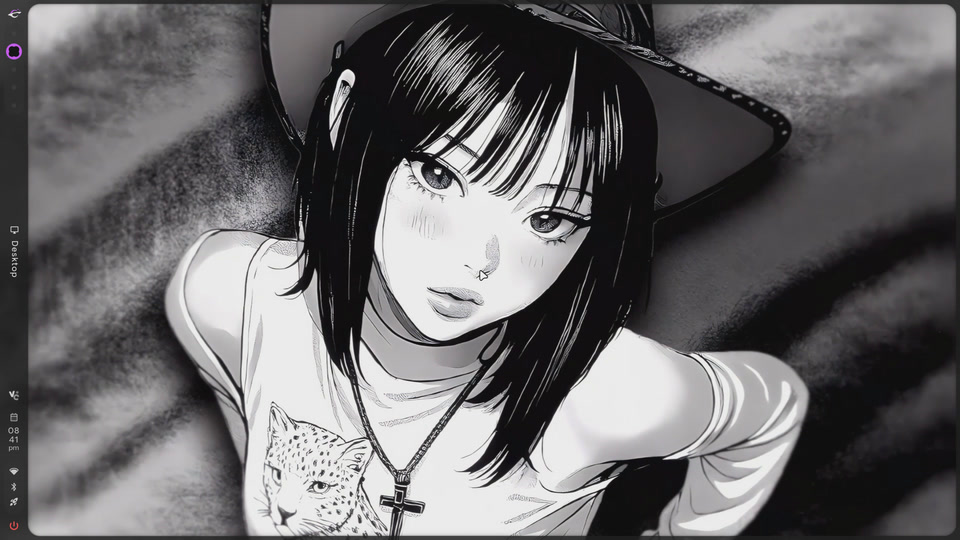](https://denoax.github.io/cachyos-amethyst-dotfiles/#launcher)

### The current shortcut guide

[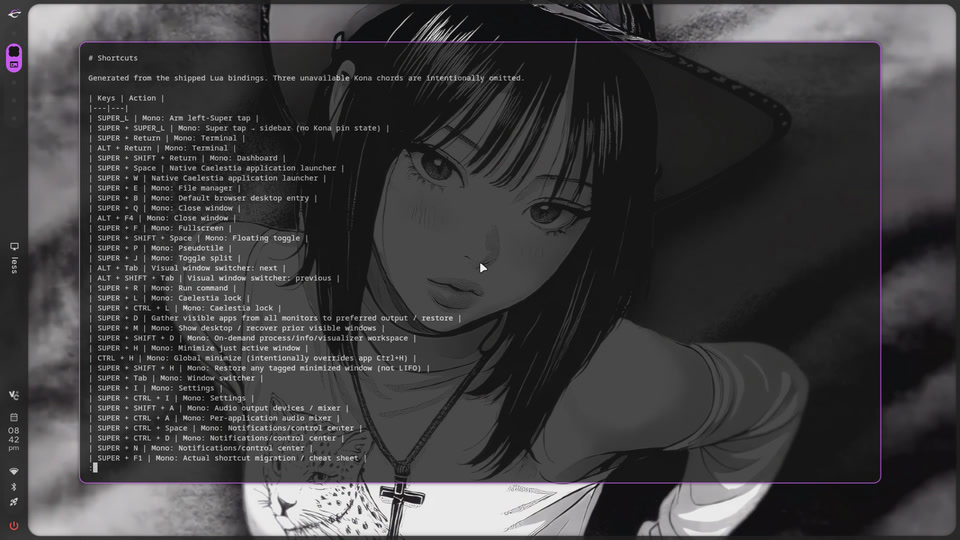](https://denoax.github.io/cachyos-amethyst-dotfiles/#shortcuts)

### Clipboard and audio controls

[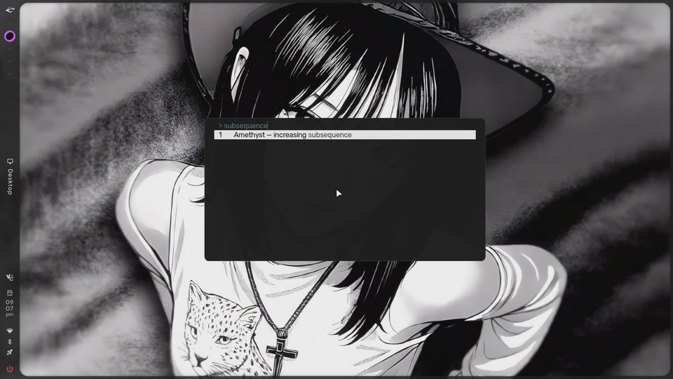](https://denoax.github.io/cachyos-amethyst-dotfiles/#clipboard)

[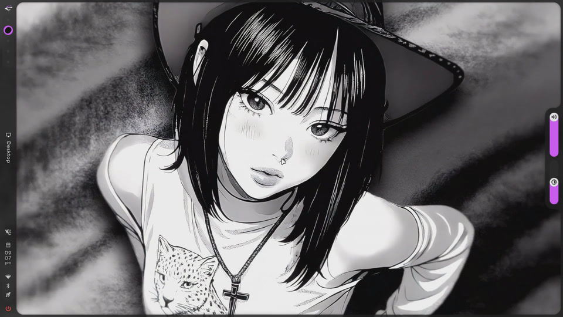](https://denoax.github.io/cachyos-amethyst-dotfiles/#audio)

</details>

## Install and recover

The desktop configuration remains **alpha**. Start from a working x86-64 CachyOS Hyprland session with distro-selected drivers. Fresh-install/first-login/laptop acceptance is pending, and the portal failures remain open. [Read the matrix](docs/VERIFICATION.md) before using it on a desktop you rely on.

This is a post-install configuration distribution. It supplies selected files, dependencies and a transactional installer. The installation fallback is a project-owned plain background; **the DesktopHut wallpaper seen in the footage is not bundled**.

[Review the official/AUR prerequisites](packages/README.md), including the exact Caelestia patch-base requirement. The installation commands below remain pinned to the tested alpha.1 configuration baseline; showcase V2 adds presentation and tooling, not new installation certification.

```sh
sudo pacman -Syu --needed git chezmoi python base-devel
git clone https://github.com/Denoax/cachyos-amethyst-dotfiles.git
cd cachyos-amethyst-dotfiles
git checkout v0.1.0-alpha.1
./install.sh doctor
./install.sh plan --profile laptop --with dev-cp,flatpak,shell-patch
./install.sh apply --profile laptop --with dev-cp,flatpak,shell-patch
./install.sh verify
```

`laptop` uses the available output's preferred mode and automatic scale. The connector-specific workstation example is opt-in. Package installation is a separate explicit step; do not downgrade a rolling system to satisfy an old patch hash.

Save the transaction ID printed by apply. Restore its owned files with:

```sh
./install.sh rollback --transaction YOUR_TRANSACTION_ID
```

Rollback preserves newer edits by stopping on conflicts. It restores owned files, permissions and internal symlinks; packages and application data remain. Repeated identical apply is a no-op. [Full install and recovery guide →](docs/INSTALL.md)

## Source, status and credits

[Architecture and ownership](docs/ARCHITECTURE.md) · [Compatibility](docs/COMPATIBILITY.md) · [Updates](docs/UPDATE.md) · [Installer validation](docs/VERIFICATION.md) · [V2 review and provenance](showcase/revision-2/REVIEW.md) · [Media manifest](showcase/revision-2/media.json)

Built around [Hyprland](https://hypr.land/), [Caelestia](https://github.com/caelestia-dots/shell) and [Quickshell](https://quickshell.org/). Presentation references: [Konata](https://github.com/Denoax/konata-hyprland-dotfiles) and the upstream Quickshell demonstrations. Their videos and artwork are not redistributed here.

The existing [DesktopHut “Black and White Look”](https://www.desktophut.com/black-and-white-look-live-wallpaper) appears in actual desktop footage at the user's request. Its raw source stays local; the code license grants no rights to extract or reuse the wallpaper. Original code is MIT, with scoped upstream GPL/MIT notices retained. [Asset and license ledger →](docs/ASSETS.md)
