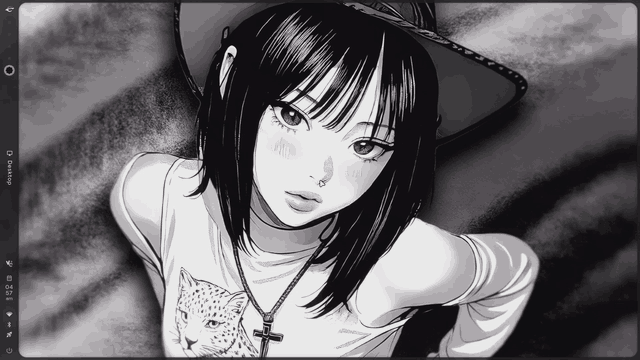

<div align="center">

# CachyOS Amethyst

Black, white, and a little amethyst. Hyprland + Caelestia, with a portable competitive-programming workspace for official Microsoft VS Code.



[Gallery](showcase/README.md) · [Install and recover](docs/INSTALL.md) · [Shortcuts](docs/SHORTCUTS.md) · [VS Code](docs/VSCODE.md) · [Validation](docs/VERIFICATION.md)

</div>

> **Experimental prerelease.** File installation and recovery are tested in disposable homes on the source CachyOS PC. A fresh CachyOS installation, first login, physical laptop and continuous human motion review remain untested. Source screen-sharing frames and the Secret portal also failed acceptance checks. Read the [tested scope](docs/COMPATIBILITY.md) before applying this to a desktop you rely on.

The repository ships selected user configuration, reviewed Caelestia patches, migrated shortcuts, a VS Code profile, templates and a bounded sample/stress runner. The laptop profile chooses the available display's preferred mode and automatic scale. The triple-monitor arrangement is an explicit workstation option.

The showcase is actual source-desktop footage. The animated wallpaper stays visible behind translucent applications, as requested. The original DesktopHut video is excluded; the default install uses a project-owned plain background. See [asset credits](docs/ASSETS.md) for the footage and wallpaper boundary.

| Desktop | Competitive programming | Daily applications |
|---|---|---|
| [](showcase/README.md) | [](showcase/README.md) | [](showcase/README.md) |

## Try the candidate

Start with an already working x86-64 CachyOS Hyprland session and distro-selected drivers. [Install the curated prerequisites](packages/README.md), including the reviewed AUR components, before applying.

```sh
sudo pacman -Syu --needed git chezmoi python
git clone https://github.com/Denoax/cachyos-amethyst-dotfiles.git
cd cachyos-amethyst-dotfiles
git checkout v0.1.0-alpha.1
./install.sh doctor
./install.sh plan --profile laptop --with dev-cp,flatpak,shell-patch
./install.sh apply --profile laptop --with dev-cp,flatpak,shell-patch
./install.sh verify
```

Package installation is a separate explicit step. Add `--install-packages` to apply only after reviewing the package plan and supplying the AUR prerequisites. It runs a full-update-safe `pacman -Syu --needed` transaction. The current Caelestia patch requires the recorded 2.5.0 package file hashes; package drift stops the patched install. Do not downgrade a rolling system merely to satisfy that check.

The installer prints a transaction ID. Restore it with:

```sh
./install.sh rollback --transaction YOUR_TRANSACTION_ID
```

Rollback preserves newer edits and reports conflicts. It restores owned files, not packages or application databases. A repeated identical apply makes no file changes and starts no extra processes. Plan and `--dry-run` create no state. Details are in the [installation guide](docs/INSTALL.md).

## Everyday controls

| Keys | Action |
|---|---|
| Super+Space / Super+W | Caelestia launcher |
| Super+Return / Super+E | Kitty / Dolphin |
| Super+D | Gather visible normal-workspace windows to the preferred output; press again to restore |
| Super+Shift+D | Open or close the owned process/info/visualizer terminal group |
| Alt+Tab | Visual window picker |
| Super+F1 | Shipped shortcut guide |
| F6 / Shift+F6 in the CP workspace | Run saved input / interactive input |
| Ctrl+Shift+B / Ctrl+Alt+N | Build / new problem |

The full [generated shortcut reference](docs/SHORTCUTS.md) has 104 literal bindings. The old assistant, profile-orchestration and Mosaic commands are excluded. Ctrl+H still minimizes globally; the editor replacement chord is Ctrl+K, then R.

## Source and maintenance

[Architecture](docs/ARCHITECTURE.md) describes file ownership and session startup. [Updates](docs/UPDATE.md) covers the rolling package boundary. [Compatibility](docs/COMPATIBILITY.md) records the observed tuple without promising that rolling repositories preserve it indefinitely.

Original code uses the MIT license, with separate GPL notices for Caelestia patches and the selected CachyOS configuration files. [License scopes and upstream sources](LICENSES/README.md) identify the exceptions. Konata was a presentation and shortcut reference; its repository and history were left unchanged.

The original handoff and project-local agent workflows are retained as [maintainer instructions](MAINTAINER_HANDOFF.md). User instructions start with this README and the install guide.
