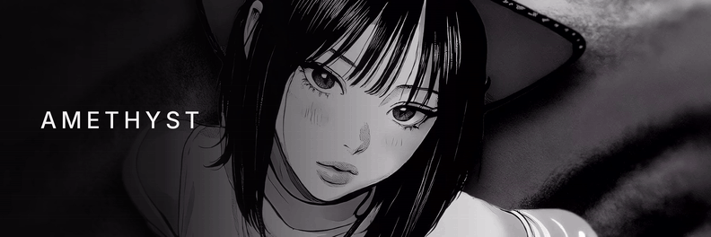

<picture>
  <source media="(prefers-reduced-motion: reduce)" srcset="assets/banner/banner.png">
  <source type="image/webp" srcset="assets/banner/banner.webp">
  
</picture>

A personal CachyOS desktop with Hyprland and Caelestia.

[Installation & recovery](docs/INSTALL.md) · [Shortcuts](docs/SHORTCUTS.md) · [Compatibility](docs/COMPATIBILITY.md) · [VS Code](docs/VSCODE.md)

**Experimental alpha.** Fresh CachyOS installation, first login and physical-laptop acceptance remain unverified. Portal failures remain open; source-PC observations do not establish fresh-system compatibility.

Review the generated file plan before applying it and retain the transaction ID for rollback. The installer manages selected user files; it does not install the OS or change boot, encryption or GPU drivers.

[Verification](docs/VERIFICATION.md) · [Troubleshooting](docs/TROUBLESHOOTING.md) · [Updates](docs/UPDATE.md) · [Asset credits](docs/ASSETS.md) · [License](LICENSE)

[Banner GIF](assets/banner/banner.gif) · [Animated WebP](assets/banner/banner.webp) · [Banner MP4](assets/banner/banner.mp4) · [Static banner](assets/banner/banner.png)

The existing banner is preserved unchanged. Its wallpaper retains its [original rights](docs/ASSETS.md); the raw wallpaper is excluded from this distribution.
