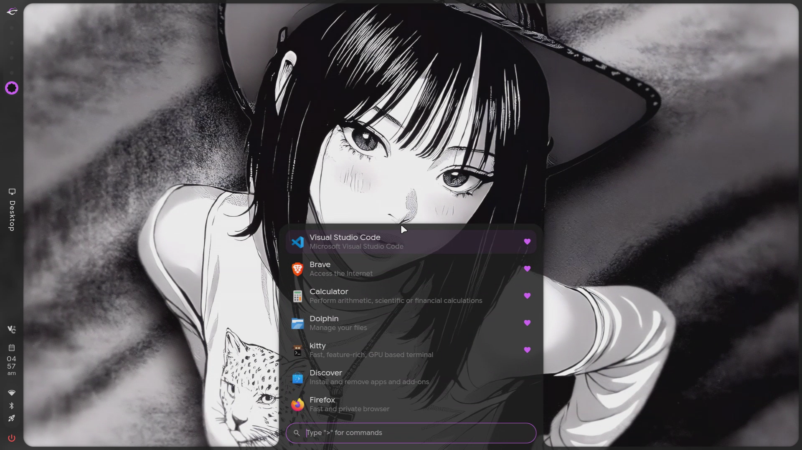
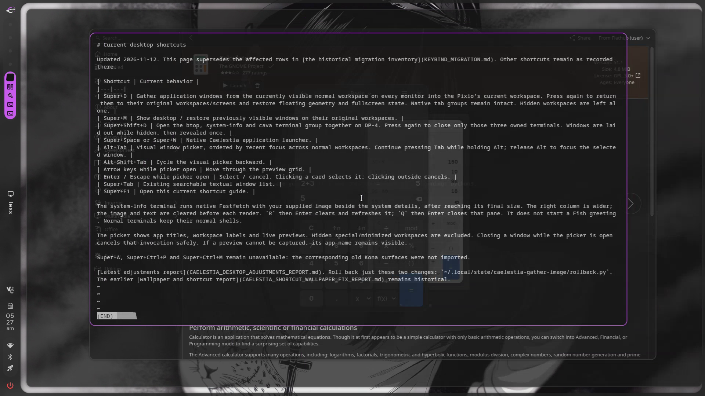
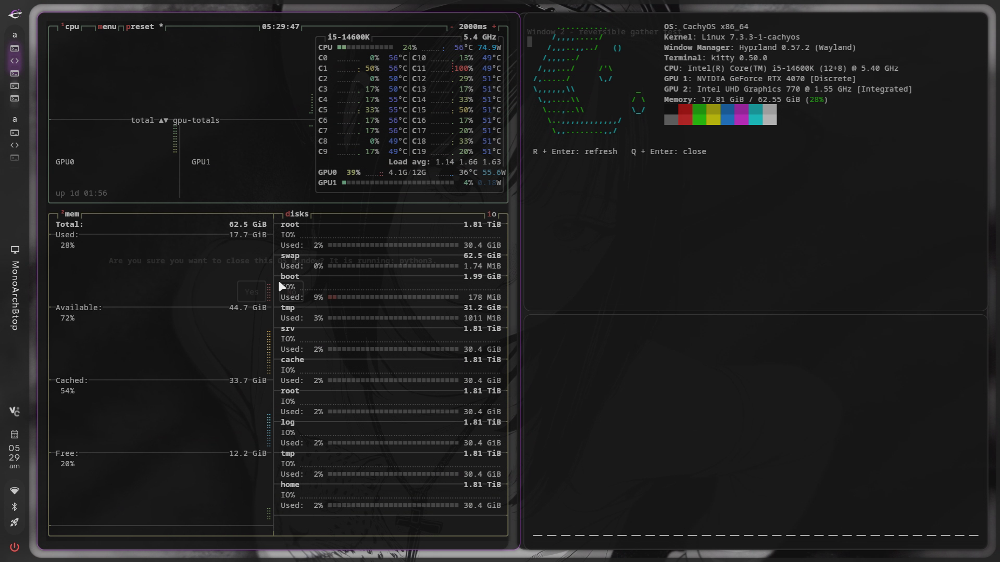
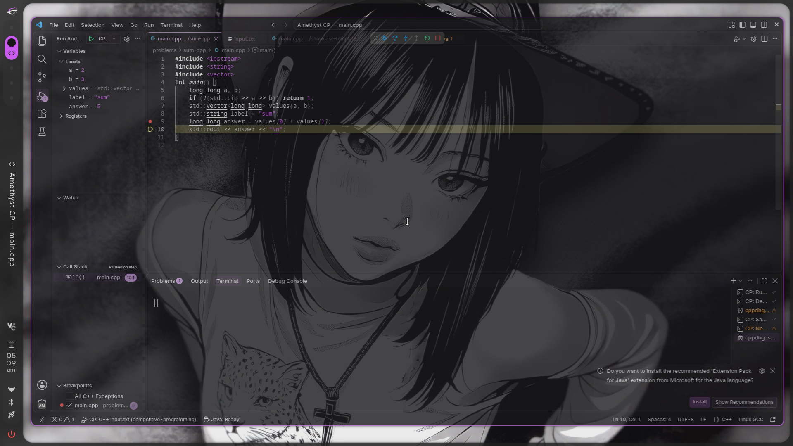
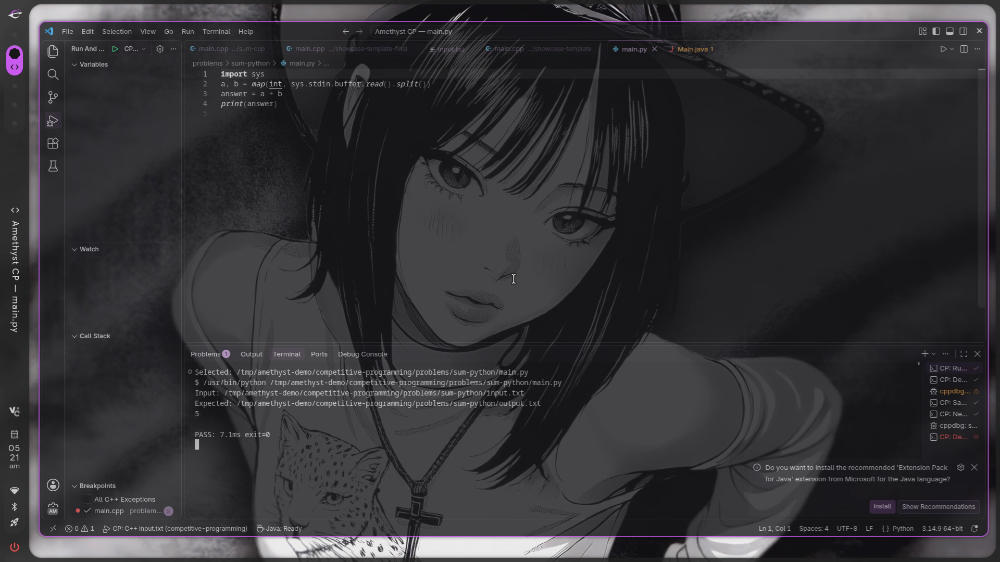
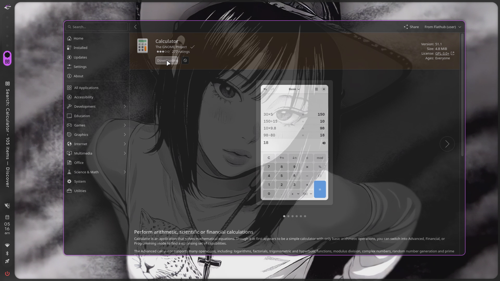
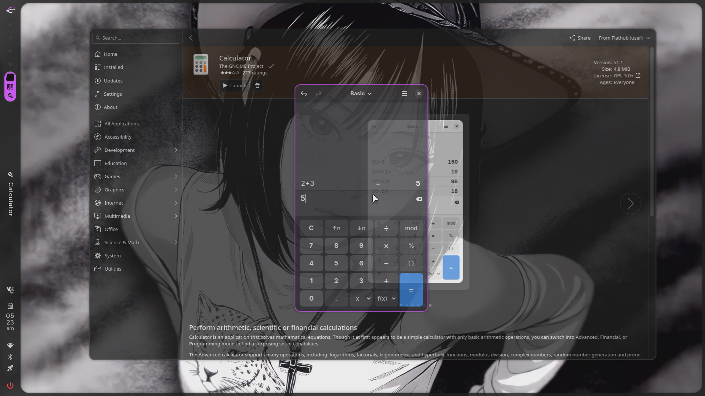
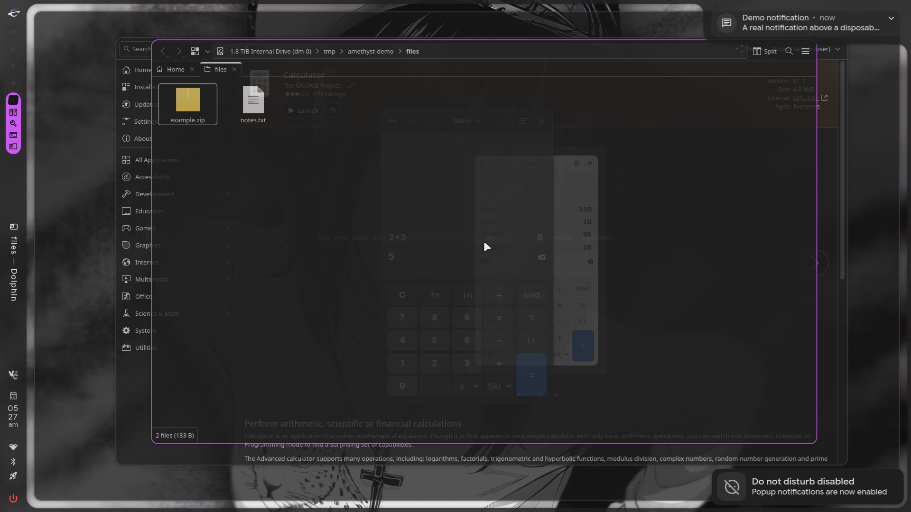

# Actual source-desktop showcase

These are 1920×1080 source-desktop recordings at a requested 30 fps, with actual timing and no invented UI. The source wallpaper appears behind translucent applications at the user’s explicit request. The raw wallpaper and capture masters are excluded. Full videos are release assets; posters and two light GIF excerpts are kept in Git.

Human continuous playback and loop-seam review remain pending. Poster/contact-sheet inspection and media probes do not establish smoothness. These clips are source-session demonstrations, not fresh-install proof.

## Desktop, animated wallpaper, launcher and controls

[Full-resolution video](https://github.com/Denoax/cachyos-amethyst-dotfiles/releases/download/v0.1.0-alpha.1/01-desktop.mp4) · [Capture and encoding manifest](assets/01-desktop.json)

## Current shortcut help and desktop menu

[Full-resolution video](https://github.com/Denoax/cachyos-amethyst-dotfiles/releases/download/v0.1.0-alpha.1/02-navigation.mp4) · [Capture and encoding manifest](assets/02-navigation.json)

## Gather/restore and on-demand system tools

[Full-resolution video](https://github.com/Denoax/cachyos-amethyst-dotfiles/releases/download/v0.1.0-alpha.1/03-window-actions.mp4) · [Capture and encoding manifest](assets/03-window-actions.json)

## C++23 input, build, samples, GDB and a new problem

[Full-resolution video](https://github.com/Denoax/cachyos-amethyst-dotfiles/releases/download/v0.1.0-alpha.1/04-vscode-cpp.mp4) · [Capture and encoding manifest](assets/04-vscode-cpp.json)

## Python, Java and a deliberate sanitizer failure

[Full-resolution video](https://github.com/Denoax/cachyos-amethyst-dotfiles/releases/download/v0.1.0-alpha.1/05-languages.mp4) · [Capture and encoding manifest](assets/05-languages.json)

## Discover installs Calculator from Flathub in user scope

[Full-resolution video](https://github.com/Denoax/cachyos-amethyst-dotfiles/releases/download/v0.1.0-alpha.1/06-discover.mp4) · [Capture and encoding manifest](assets/06-discover.json)

## Caelestia launches the installed Flatpak

[Full-resolution video](https://github.com/Denoax/cachyos-amethyst-dotfiles/releases/download/v0.1.0-alpha.1/06-flatpak-launch.mp4) · [Capture and encoding manifest](assets/06-flatpak-launch.json)

## Disposable files, clipboard and a real notification

[Full-resolution video](https://github.com/Denoax/cachyos-amethyst-dotfiles/releases/download/v0.1.0-alpha.1/07-daily.mp4) · [Capture and encoding manifest](assets/07-daily.json)

## Scope and edits

The clips are uncut at normal speed. GIFs are downsampled excerpts with adaptive palettes. No interpolation or masked metrics are used. The system-info demo uses portable ASCII rather than the source PC’s local image; its btop view excludes process/network panels. Terminal helpers were invoked directly or through actual editor UI events; physical keys across every monitor remain unverified.

Discover’s new user export directory required a supported refresh of the existing managed Caelestia shell before the native launcher selected the Flatpak. The sandboxed process was then verified. Earlier rehearsal/failure recordings remain private and are not represented as successful checks.

Screen-sharing selection returned dimensions but the first browser preview produced no video frames. It is not published as a successful scene. Physical laptop and fresh-VM scenes are absent because no tested environment was available. See [the validation matrix](../docs/VERIFICATION.md).

[Asset rights and wallpaper boundary](../docs/ASSETS.md) · [Local HTML gallery](gallery.html)
