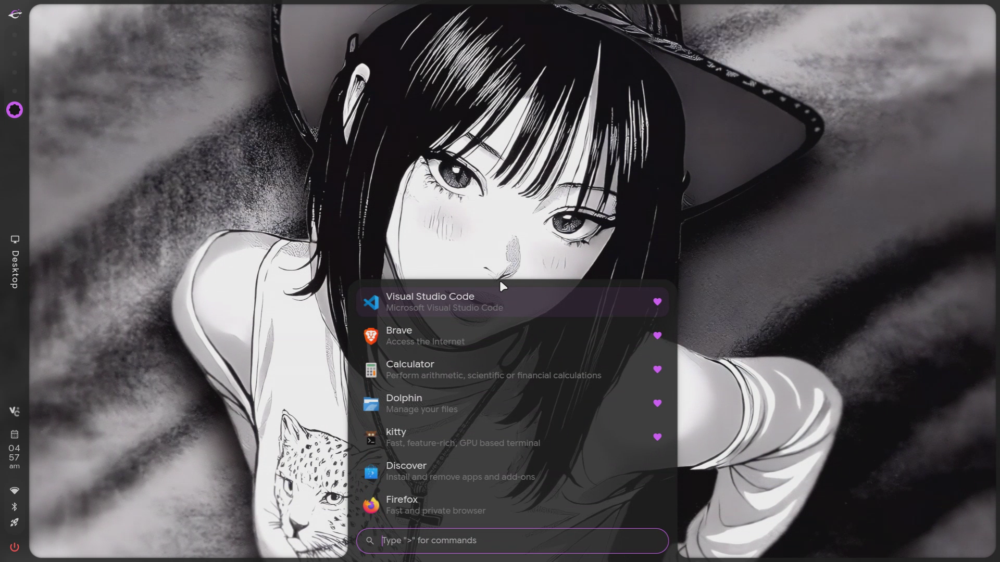
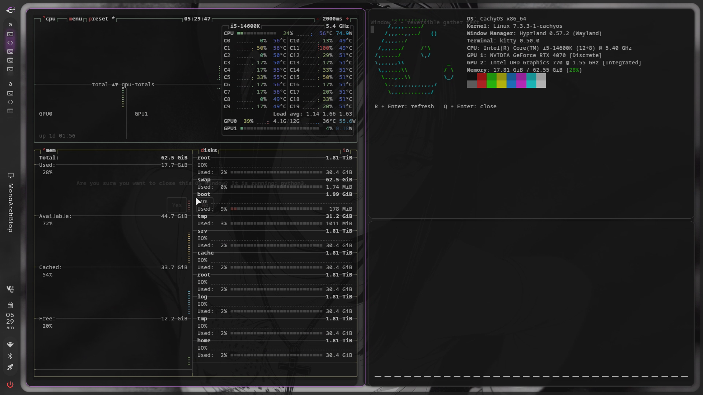
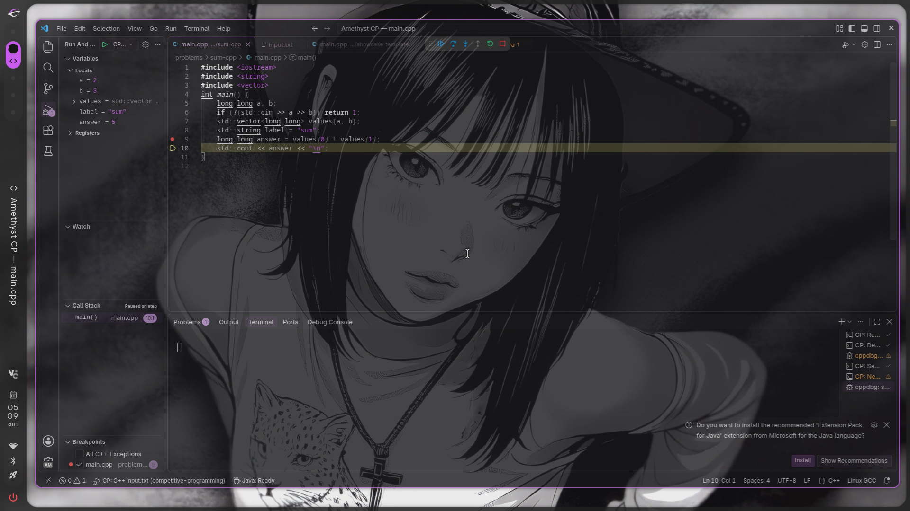

# Amethyst

A CachyOS workstation, in motion.

[Watch the tour](https://denoax.github.io/cachyos-amethyst-dotfiles/) · [Install](../../../docs/INSTALL.md) · [Shortcuts](../../../docs/SHORTCUTS.md)

**Experimental alpha.** [Tested scope](../../../docs/VERIFICATION.md).

## The desktop

## Built for problem solving

## Daily Linux

*Layout comparison with identical alpha.1 media. New captures replace these in the selected direction.*
